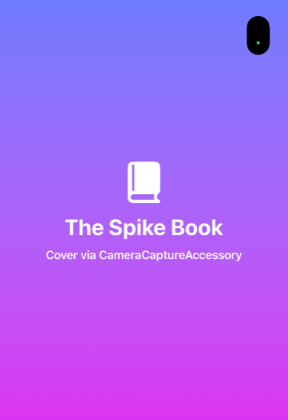

# Spike: the book's cover on the outer screen while the Duo is open

Issue: #31 · Date: 2026-11-04 · Tools: Xcode 27.1 (27A9275), iOS 27.1 simulator, iPhone Duo

## Answer

It can be done, with one API: **`CameraCaptureAccessory`** (SwiftUI) /
`UISceneAccessory.cameraCapture(sceneConfiguration:)` (UIKit), new in iOS 27.1.
When the Duo is fully open and the app is in front, the system hosts the
accessory's view in a scene on the outer ("cover") display. In the simulator,
the prototype's cover filled the outer panel while the reader UI ran on the
inner panel.

The catch: Apple scopes this accessory to camera apps. On hardware the system
shows it **only while the app has a running `AVCaptureSession`** (Apple
Developer Forums summary, thread 847644). The simulator does not enforce that,
which is why the cover appeared there with no camera at all. Actually Read's
"Performative Mode" ships exactly this way: a small live camera preview keeps
a session running so the cover stays on the outer screen.

## What was tested on a real iPhone Duo (iOS 27.1)

| Experiment | Result |
| --- | --- |
| Fully open, accessory registered, **no** capture session | `available` stays `false`; nothing on the outer screen. The camera requirement is enforced on hardware. |
| Fully open, front camera running (`.low` preset, 1 fps, no outputs) | `available=true` about 2 s after launch; the accessory scene connects and the cover fills the outer screen. The camera-in-use dot shows on the outer screen too. |
| Battery cost | Not measured yet; tracked in #94 for before release. |

## What was tested (simulator)

| Experiment | Result |
| --- | --- |
| `onHingeChange` | Reports `closed` → `partiallyOpen` → `fullyOpen` as the hinge moves. |
| `UIScreen.screens` when open | 2 screens: outer 466×678 pt, inner 951×669 pt (@3x). The app's scene moves to the inner one. |
| `CameraCaptureAccessory`, folded | `available=false`; nothing on the outer screen (the app *is* on the outer screen). |
| `CameraCaptureAccessory`, fully open, no capture session | `available=true`; a scene with role `UIWindowSceneSessionRoleCameraCaptureAccessory` connects; SpringBoard logs `Scene Accessory CoverDisplay Presented`; the cover renders on the outer panel. |
| `CameraCaptureAccessory`, half open (~90°, `partiallyOpen`) | Same as fully open: available, cover on the outer panel. Hardware may differ; third-party write-ups say fully open only. |
| Toggle `isEnabled` off / on | Scene disconnects and the outer panel goes dark / scene reconnects and the cover returns. Clean mapping for a user setting. |
| `ExternalNonInteractiveAccessory` | Never available. It's for real external displays (AirPlay, cable), not the cover panel. |
| Legacy `UIWindow.screen = outer` | A screen-based scene connects but nothing draws; the outer panel stays black. Dead end. |
| Fold state across a simulator reboot | Kept only while Device Hub stays open. After Device Hub quit, a reboot came back closed. A rebooted Duo comes back unlocked. |

## Not yet verified

- Battery cost of the session on hardware (#94, `-batteryTest` launch flag).
- Whether the accessory survives the half-open pose on hardware.

## Options

1. **Camera-backed cover (recommended, opt-in).** A "Show cover on the outside"
   setting. Turning it on asks for camera permission once, then the reader
   runs a minimal session while open: front camera, `.low` preset, lowest
   frame rate, no outputs (no frames ever reach the app), and a small visible
   preview in the reader chrome. Costs: the camera indicator dot shows, some
   battery, and App Review risk because Apple calls camera cases the "only
   supported and intended" use (FB25262170). Precedent: Actually Read shipped
   it.
2. **Closed-only cover (fallback, always available).** When folded, the app
   already runs on the outer screen, so the reader can show a cover view there
   with no camera. Used when option 1 is off, denied, or rejected in review.
3. **Ask Apple for a proper API.** Duplicate FB25262170 ("Allow non-camera
   scene accessories on the outer display") so a future iOS can drop the
   camera.

## Implementation notes for the real feature

- Attach `.sceneAccessory { CameraCaptureAccessory(isEnabled:) { … } }` to the
  reader view only. The system presents the top-most registration, so only one
  screen should register.
- Observe `onAvailabilityChange`; the system withdraws the content when the
  device closes, the app backgrounds, or capture stops. The app must work
  fully without it.
- Content: `BookCoverView(book:)` from the cover library, filling 466×678 pt
  (1398×2034 px). The cover is 2:3 and the panel ~0.69, so fill the spare edge
  with the cover's dominant colour. Requested a larger render from the cover
  thread.
- Start/stop the session with the reader's lifecycle and the setting; never
  run it on the shelf.
- Privacy manifest and the camera usage string must say the camera is used
  only to keep the cover visible and nothing is recorded.
- Lay out from the hinge and size classes, never device idiom.

## Prototype

`DuoReader/Spikes/OuterScreenCoverSpike.swift`, DEBUG only. Launch with
`-coverSpike` (plus `-autoCamera`, `-toggleCameraAccessory`,
`-noCameraAccessory`, `-legacyWindow`, `-batteryTest` for the individual experiments). It logs
to Documents/cover-spike.log. Delete it when the real feature lands.

## Sources

- [Apple Developer Forums: iPhone Duo group lab summary](https://developer.apple.com/forums/thread/847644)
- [FB25262170: allow non-camera scene accessories on the outer display](https://github.com/feedback-assistant/reports/issues/848)
- [Bleeping Swift: teleprompter with CameraCaptureAccessory](https://bleepingswift.com/blog/cameracaptureaccessory-iphone-duo-teleprompter)
- [unwire.hk: Actually Read's cover mode uses the camera API](https://unwire.hk/2026/10/25/iphone-duo-actually-read-book-cover-camera-api/software/iphone-app/)
- SDK headers: `UISceneAccessory.h`, `UIHinge.h`, `UIHingeInteraction.h`, `UIWindowScene.h` in the iOS 27.1 SDK.
